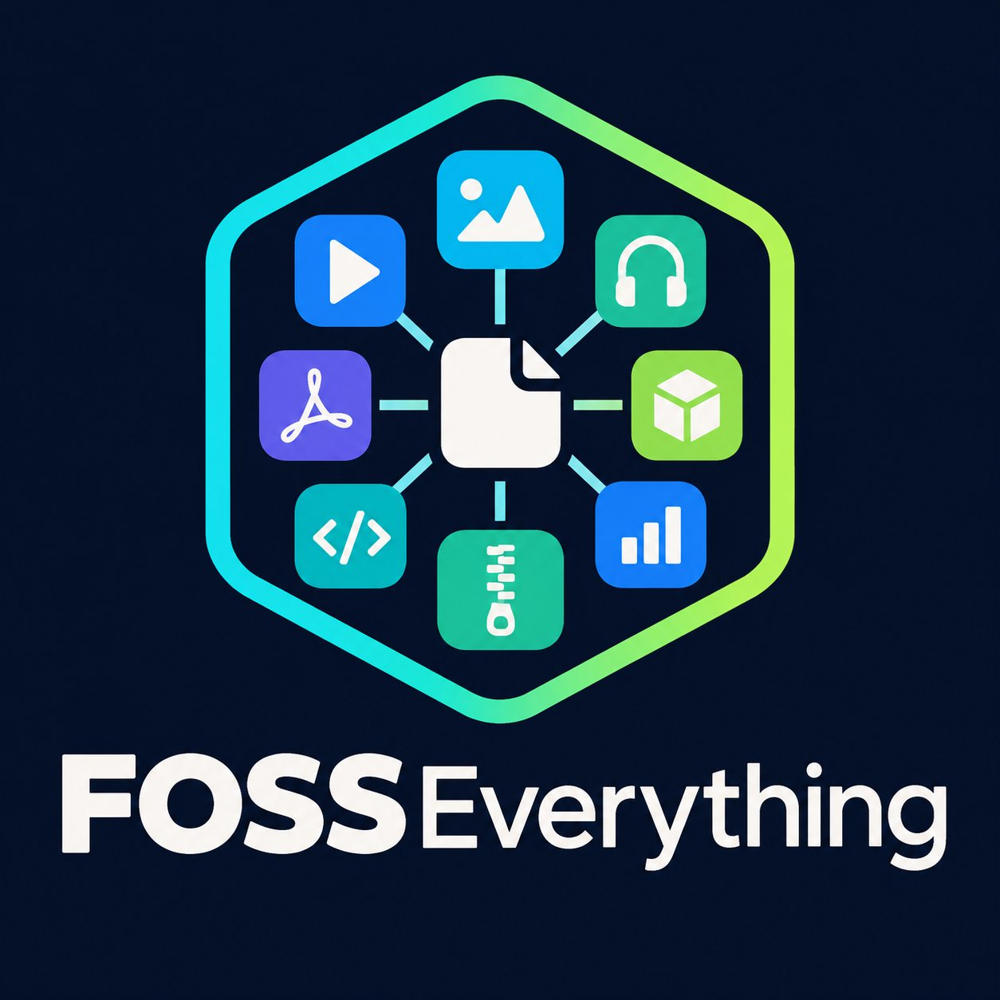
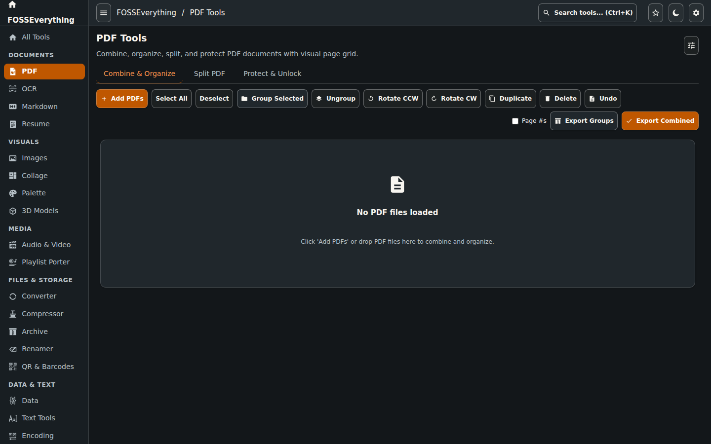

  

# FOSSEverything

**All-in-one offline desktop utility suite for PDFs, images, audio, video, 3D models, archives, and data.**

FOSSEverything runs completely locally on Windows, macOS, and Linux with zero cloud uploads, accounts, or tracking. Convert files, edit PDFs, inspect 3D parts, strip metadata, and run batch utilities from one clean window.

---

## Download

| Platform | Download | Setup Guide |
| :--- | :--- | :--- |
| Windows | [FOSSEverything-Windows.exe](https://github.com/DontKwo/FOSSEverything/releases/latest/download/FOSSEverything-Windows.exe) | [Windows Install Steps](docs/INSTALLATION.md#windows) |
| macOS | [FOSSEverything-macOS.dmg](https://github.com/DontKwo/FOSSEverything/releases/latest/download/FOSSEverything-macOS.dmg) | [macOS Install Steps](docs/INSTALLATION.md#macos) |
| Linux | [FOSSEverything-Linux.tar.gz](https://github.com/DontKwo/FOSSEverything/releases/latest/download/FOSSEverything-Linux.tar.gz) | [Linux Install Steps](docs/INSTALLATION.md#linux) |

---

## Screenshots

  

  

---

## How to Use

1. Download the package for your operating system from the table above.
2. Follow the [Desktop Installation Guide](docs/INSTALLATION.md) if Windows SmartScreen or macOS Gatekeeper warns about an unrecognized app.
3. Launch **FOSSEverything**, press `Ctrl+K` (`Cmd+K` on macOS) or drag any file onto the window to open the matching tool.

---

## Key Features

- **Document & PDF Studio**: Merge, split, compress, encrypt, watermark, redact, and run offline OCR on PDFs.
- **Media, Image & 3D Tools**: Batch convert formats, remove image backgrounds locally, extract palettes, and slice STL/OBJ/STEP models.
- **Data, Security & Archives**: Format JSON/YAML/TOML/CSV/SQL, inspect local network sockets, strip EXIF/ID3 metadata, and verify archives offline.

---

## Safety & Disclaimers

- **Official `main` Releases Only**: Download installers exclusively from [DontKwo/FOSSEverything Releases](https://github.com/DontKwo/FOSSEverything/releases/latest) (`main` branch). Never run forked builds unless you are sure they contain no malware; only official `main` releases are maintained by the author, and I make no promises.
- **OS Security Warnings**: Windows SmartScreen and macOS Gatekeeper will likely warn that independently built executables are unrecognized or unsafe. Bypassing prompts is strictly at your own discretion using [Desktop Installation Guide](docs/INSTALLATION.md).
- **File & System Modifications Disclaimer**: FOSSEverything transforms local files, metadata, and optional OS context-menu entries when requested. Provided "AS IS" under the [MIT License](LICENSE) with zero warranty or liability; keep backups and run batch operations at your own risk.

---

## Documentation

### User Documentation
- [User Guide](docs/USER_GUIDE.md)
- [Desktop Installation Guide](docs/INSTALLATION.md)
- [Frequently Asked Questions](docs/FAQ.md)
- [Privacy Statement](PRIVACY.md)

### Developer Documentation
- [Developer Guide](docs/DEVELOPMENT.md)
- [Developer uv Installation](docs/UV_INSTALLATION.md)
- [Contributing Guidelines](CONTRIBUTING.md)

### AI, Technical & Reference Documentation
- [AI Agent Reference](AGENTS.md)

### Legal & Security Policies
- [Security Policy](SECURITY.md)
- [Third-Party Notices](THIRD_PARTY_NOTICES.md)
- [MIT License](LICENSE)
