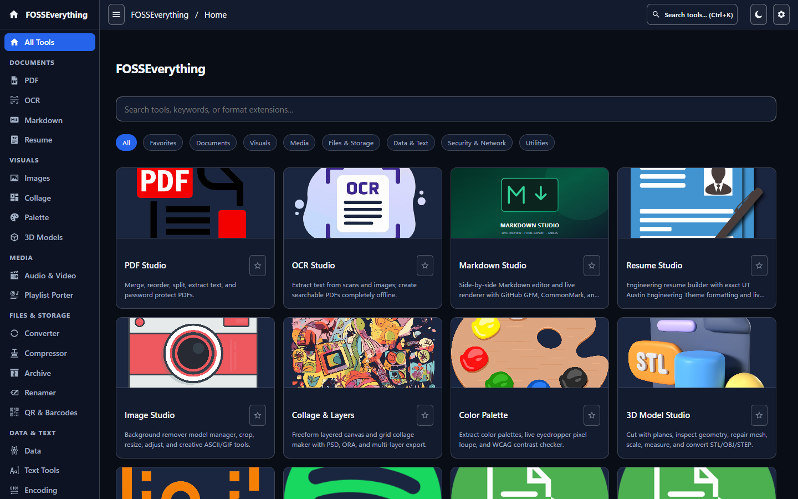
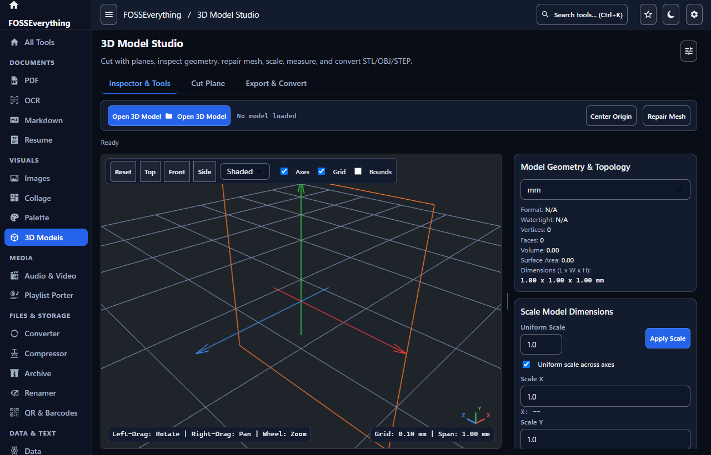
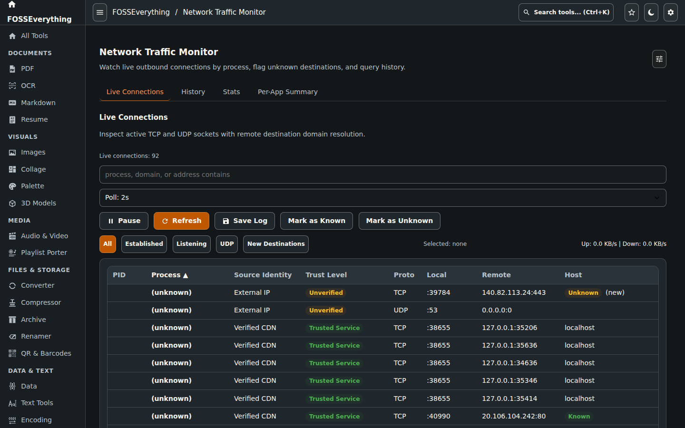
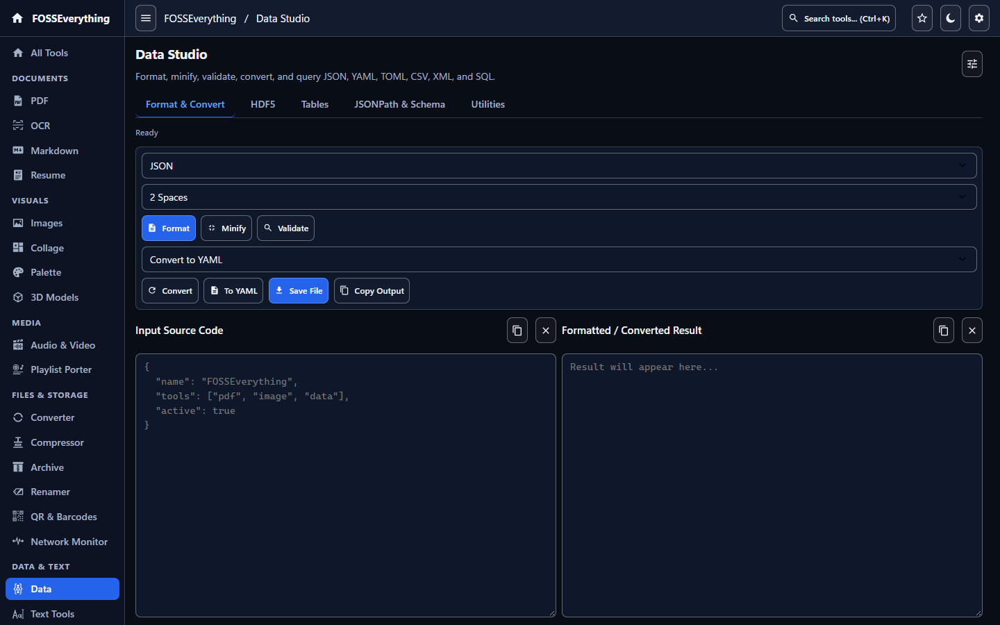
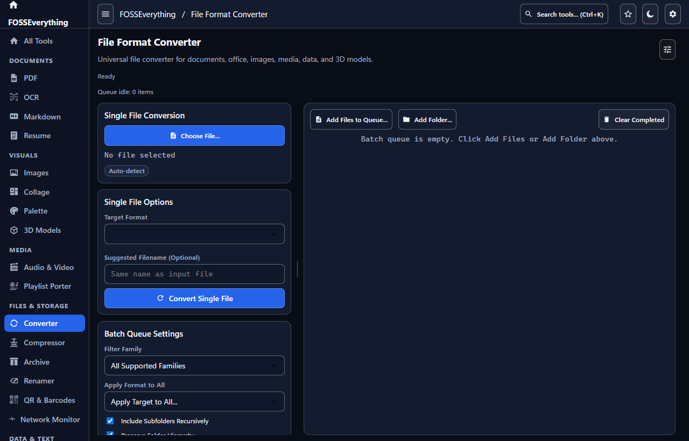

<div align="center">
  

  # FOSSEverything

  **The offline desktop power tool for documents, media, data, and daily workflows.**

  [](PRIVACY.md)
  [](https://github.com/DontKwo/FOSSEverything/releases/latest)
  [](https://github.com/DontKwo/FOSSEverything/releases)
  [](https://github.com/DontKwo/FOSSEverything/actions/workflows/build-exe.yml)
  [](LICENSE)

</div>

---

FOSSEverything is a desktop utility suite for editing documents, manipulating media, inspecting 3D models, converting datasets, and monitoring system network connections. Every operation executes entirely on your physical machine with zero cloud tracking, zero account requirements, and zero remote telemetry.

---

## Downloads

Every push to `main` builds all platforms and publishes a new [GitHub release](https://github.com/DontKwo/FOSSEverything/releases/latest). These links always point to the newest one:

| Platform | Download | How to install |
|---|---|---|
| **Windows** | [FOSSEverything-Setup.exe](https://github.com/DontKwo/FOSSEverything/releases/latest/download/FOSSEverything-Setup.exe) | Installer wizard: pick folder, components, shortcuts, theme |
| **Windows** | [FOSSEverything-Portable-win64.zip](https://github.com/DontKwo/FOSSEverything/releases/latest/download/FOSSEverything-Portable-win64.zip) | Extract anywhere and run `FOSSEverything.exe` |
| **macOS** | [FOSSEverything-macos.dmg](https://github.com/DontKwo/FOSSEverything/releases/latest/download/FOSSEverything-macos.dmg) | Open the DMG and drag the app to Applications |
| **macOS** | [FOSSEverything-Portable-macos.zip](https://github.com/DontKwo/FOSSEverything/releases/latest/download/FOSSEverything-Portable-macos.zip) | Extract and run `FOSSEverything.app` |
| **Linux** | [FOSSEverything-Portable-linux64.tar.gz](https://github.com/DontKwo/FOSSEverything/releases/latest/download/FOSSEverything-Portable-linux64.tar.gz) | Extract and run `./install.sh` (use `--help` for options) |

Older versions and `SHA256SUMS.txt` are on the [Releases page](https://github.com/DontKwo/FOSSEverything/releases). Installer options, silent install flags, and first-launch warnings (SmartScreen, Gatekeeper) are covered in the [User Guide](docs/USER_GUIDE.md#installing).

---

## Feature Showcase

### Application Hub & Global Command Palette
Launch capabilities, search with natural language keywords, and access pinned favorites instantly with `Ctrl+K` (`Cmd+K` on macOS).



---

### PDF Studio
Merge, split, reorder, compress, encrypt, water-mark, and redact PDF documents locally.


---

### Interactive 3D Model Viewer
Inspect STL, OBJ, PLY, GLTF, and STEP 3D models with bounding box diagnostics, wireframe shading, and cross-section slicing.



---

### Local Network Monitor
Audit open network sockets, active TCP/UDP connections, listening ports, process owners, and bandwidth transfer rates.



---

### Data Studio & Converter
Format, validate, query, and minify structured datasets including JSON, YAML, TOML, XML, and CSV with live syntax highlighting.



---

### Universal Media Converter & Batch Compressor
Transcode images, audio, video, and documents with configurable compression presets and stream-copy audio extraction.



---

## Core Tool Suites

| Suite | Included Tools | Key Capabilities |
|---|---|---|
| **Documents** | PDF Studio, OCR & Text, Markdown Editor, Resume Builder | Merge/split PDFs, offline Tesseract OCR in 18+ languages, live Markdown preview, ATS resume exporter |
| **Visuals** | Image Studio, Photo Collage, Color Palette, 3D Viewer | Redaction, cropping, filters, EXIF metadata viewer, palette extraction, 3D mesh slicing |
| **Media** | Audio/Video Studio, Playlist Manager | Stream-copy trimming, MP3/WAV/AAC extraction, M3U8 parsing, format transcoding |
| **Files & Storage** | File Converter, Compressor, Archive Tools, Batch Renamer | Batch media conversion, ZIP/TAR/7Z extraction, regex renaming, collision previews |
| **Data & Text** | Data Studio, Text Tools, Encoding, Unit Converter | JSONPath queries, regex search/diff, Base64/Hex/URL codec, Pint physical unit engine |
| **Security & Network** | Network Monitor, Sherlock OSINT, Metadata Tools | Live socket inspector, username search across 300+ platforms, EXIF/ID3 stripper |
| **Utilities** | QR & Barcodes | Vector SVG QR code generator with logo embedding, file and webcam barcode scanner |

---

## Native Desktop & Shell Integration

FOSSEverything integrates with desktop operating systems:
- **File Drag & Drop**: Drop files anywhere onto the window to route directly to the matching tool.
- **Single-Instance IPC**: Launching a file forwards it to your active window over local TCP socket `127.0.0.1:47891`.
- **Context Menus**: Register "Open in FOSSEverything" in your system file explorer:
  ```bash
  # Windows, macOS, or Linux
  python main.py --register-shell

  # Remove integration
  python main.py --unregister-shell
  ```

---

## Documentation Links

- [Developer Guide & Architecture](docs/DEVELOPMENT.md): Source installation, architecture overview, test runners, and build procedures.
- [User Guide](docs/USER_GUIDE.md): End-user usage tips, shortcuts, and tool manuals.
- [Frequently Asked Questions (FAQ)](docs/FAQ.md): Common troubleshooting and platform questions.
- [Contributing Guidelines](CONTRIBUTING.md): PR guidelines, coding invariants, and testing standards.
- [Privacy Policy](PRIVACY.md): Data handling guarantees and offline architecture specification.
- [Third-Party Notices](NOTICES.md): Open source licenses and library acknowledgments.

---

## Quick Start (From Source)

For developers running from Git:

```bash
git clone https://github.com/DontKwo/FOSSEverything.git
cd FOSSEverything

# Install dependencies and start
uv sync
uv run python main.py
```

For complete development instructions, see [docs/DEVELOPMENT.md](docs/DEVELOPMENT.md).

---

## License

FOSSEverything is distributed under the GNU Affero General Public License v3.0 or later. See [LICENSE](LICENSE) for details.
